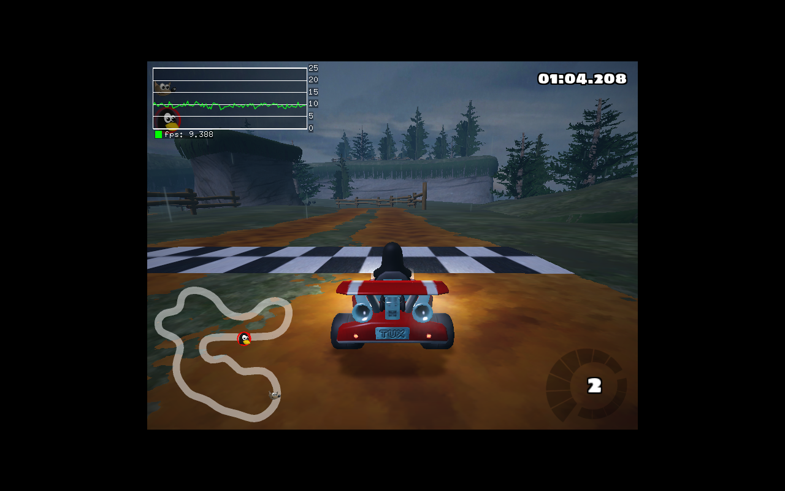

# XEF

XEF runs Linux AArch64 (arm64) programs on x86-64 Linux: a user-mode binary translator with a
two-tier JIT (per-block tier 1, hot-loop regions in tier 2). It runs command-line tools, X11 /
GTK / Qt applications, web browsers and OpenGL / Vulkan games, and can hand the guest's GL,
GLES, EGL and Vulkan calls to the host's native drivers.



## Build

```sh
tools/setup.sh                                   # cmake/ninja, arm64 sysroot, qemu (test oracle), sources
export PATH=$PWD/.tools/venv/bin:$PATH
cmake -S . -B build -G Ninja -DCMAKE_CXX_COMPILER=clang++ && ninja -C build
tools/build_thunks.sh                            # guest shims for --host-gl (libGL / libvulkan)
```

## Run

```sh
build/xef program args...                        # static arm64 binaries
tools/mkrootfs.sh [packages...]                  # arm64 root filesystem (Ubuntu noble + dependencies)
build/xef -L .tools/rootfs-arm64 .tools/rootfs-arm64/usr/bin/python3 -c 'print(42)'
```

Graphical programs use the host X server (`$DISPLAY`). With `--host-gl` OpenGL/GLES/EGL/Vulkan
run on the host's native libraries (llvmpipe or the real GPU driver) instead of the guest's
emulated Mesa — usually several times faster:

```sh
tools/mkrootfs.sh supertuxkart
build/xef --host-gl -L .tools/rootfs-arm64 .tools/rootfs-arm64/usr/games/supertuxkart
```

`docs/GUI.md` lists what has been verified (Neverball, Extreme Tux Racer, OpenArena, Minetest,
SuperTuxKart, Warzone 2100, GIMP, WebKitGTK with WebGL, vkcube, ...) with screenshots.

## Options

| | |
|---|---|
| `-L DIR` / `XEF_ROOTFS` | guest root filesystem (absolute guest paths resolve there first) |
| `--host-gl` / `XEF_HOST_GL=1` | native host OpenGL/GLX/EGL/GLES/Vulkan |
| `--stats` | translation and runtime statistics at exit |
| `--profile` | hottest translated blocks and time outside translated code (`XEF_PROFILE_AT=N`: report after N seconds) |
| `--no-tier2`, `--tier2-threshold N` | tier-2 region compiler control |
| `--trace` | debugging: no block linking, show the last blocks on a jump to unmapped code |
| `--dump-ir`, `--dump-code` | IR / host code of every block |
| `XEF_VERIFY=lo-hi` | debugging: check every scalar block starting in the range against a reference IR interpreter |
| `XEF_SPLIT=lo-hi[,lo-hi]` | debugging: translate blocks starting there one instruction at a time (bisecting translation bugs) |
| `XEF_DUMP=lo-hi` | limit `--dump-ir` / `--dump-code` to blocks starting in the range |
| `XEF_STRICT_FLAGS=1` | do not assume NZCV is dead at calls/returns (hand-written asm passing flags) |

## Documentation

- `docs/ARCHITECTURE.md` — design of the translator
- `docs/memory-model.md` — AArch64 ordering on x86-TSO
- `docs/GUI.md` — GUI applications, games, host GL/Vulkan
- `docs/benchmarks.md` — performance
- `docs/HANDOFF.md` — current state and next steps (Polish)

## Tests

```sh
tests/guest/run.sh                                         # C/C++ programs: XEF vs qemu-aarch64
tests/rootfs/run.sh                                        # -L path handling (symlinks inside the rootfs)
tests/gui/run.sh                                           # --host-gl shims
(cd tests/diff && python3 fuzz.py -n 3000 --class all)     # random instructions vs qemu
```
