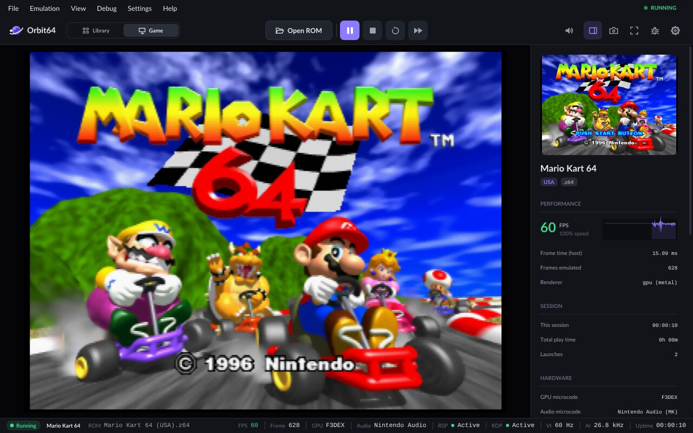

# XEF-OSX

**XEF-OSX** runs **macOS ARM64 (Apple Silicon / Darwin AArch64)** programs on **x86-64 Linux**. It is a
binary translator plus a macOS compatibility layer: no Mac, no VM, no macOS kernel — the app's arm64 code is
JIT-compiled to x86-64 and its system calls, frameworks and graphics are provided on top of Linux.

| Balatro (LÖVE, OpenGL) | Orbit64 + Mario Kart 64 (SDL3, Metal → Vulkan, 60 FPS) |
|---|---|
|  |  |

Both are the unmodified macOS arm64 builds, running on a Linux x86-64 PC.

## What's inside

1. **Two-tier JIT (AArch64 → x86-64)** from the **XEF** project: ARM64 decoder, IR optimizations, a Tier-1
   per-block JIT and a Tier-2 region compiler.
2. **macOS (Darwin) compatibility layer**, inspired by and partly adapted from **Darling**:
   - **Mach-O 64-bit ARM64** loader (`MH_MAGIC_64`) and **FAT / Universal** binaries (`FAT_MAGIC` /
     `FAT_CIGAM`), picking the arm64 slice automatically; `__PAGEZERO` (4 GB guard), `__TEXT`, `__DATA`,
     `__LINKEDIT`, BSS; `LC_MAIN` and `LC_UNIXTHREAD` entry points; dyld-style binding (incl. weak binds).
   - **macOS commpage** (`0x00007fffffe00000` and `0x0000000fffffc000`) with CPU, version and system data.
   - **Darwin / Apple Silicon stack layout** (`argc`, `argv`, `envp`, `apple` with `executable_path=...`,
     16-byte alignment).
   - **Darwin system calls**: BSD syscalls (`x16`, `svc #0x80` / `svc #0`; `stat64`, `open`, `mmap`,
     `ulock_wait`/`ulock_wake` → Linux futex, `sysctl`, `getentropy`, `pipe`, `ioctl`, …) with Darwin's error
     convention (carry flag `C=1` on error), and **Mach traps** (`mach_reply_port`, `thread_self_trap`,
     `task_self_trap`, `host_self_trap`, `mach_timebase_info_trap`, `mach_msg_trap`, …).
   - **libSystem in HLE** (`src/loader/darwin_hle.cpp`, `darwin_sys_shims.cpp`, `darwin_stubs.cpp`,
     `darwin_mach.cpp`), with real arm64 libraries built from open source for the rest (see below).
   - **Swift runtime** support (Swift 5.1–6.0 symbols, metadata tables).
3. **Graphics and UI**:
   - **AppKit-lite** (`rootfs-src/appkit`): windows, views, controls, menus, text, nib/storyboard loading and
     CoreGraphics drawing, presented to the host X server (works under Xwayland).
   - **OpenGL.framework**, `NSOpenGLView` / `NSOpenGLContext`, GLFW: GL calls run on the host's native libGL.
   - **Metal** on the GPU through **MetalVK** (Metal → Vulkan 1.3). Shaders are translated by `xef-mtlc`, a
     separate process that turns AIR (`.metallib`) and Metal Shading Language source into SPIR-V.
     `CAMetalLayer`, MetalKit and SDL3's GPU API work. See [docs/GUI.md](docs/GUI.md).
   - **Sound** through the host's PulseAudio / PipeWire-Pulse server (CoreAudio, OpenAL, SDL).

### Known to work

| Program | Notes |
|---|---|
| Balatro | LÖVE 11 (SDL2 + OpenGL + OpenAL), full game |
| Orbit64 (N64 emulator) | SDL3 + Metal; ImGui UI and Mario Kart 64 at 60 FPS |
| All 34 SDL3 GPU samples, Xcode "Metal Game" template | Metal → Vulkan |
| vkcube through MoltenVK | Vulkan → MoltenVK → Metal → Vulkan |
| Small AppKit apps (Stickies, TextEdit-style apps, Rectangle, TrackWeight, …) | AppKit-lite 2D |

More notes on the graphics stack are in [docs/GUI.md](docs/GUI.md) and [docs/ARCHITECTURE.md](docs/ARCHITECTURE.md);
the development log (in Polish) is [docs/HANDOFF.md](docs/HANDOFF.md).

---

## Building

Requirements: Clang, CMake, Ninja; for Metal also LLVM/Clang development libraries and SPIRV-Tools
(`xef-mtlc` links against `libclang-cpp`, `libLLVM` and `libSPIRV-Tools-shared`).

```bash
cmake -S . -B build -G Ninja -DCMAKE_CXX_COMPILER=clang++
ninja -C build
```

This produces `build/xef-osx` (a symlink to `build/xef`) and the shader compiler `build/mtlc/xef-mtlc`, which
`xef-osx` looks for next to itself (`mtlc/xef-mtlc` or `xef-mtlc`, or `$XEF_MTLC`).

Runtime host dependencies (loaded with `dlopen`, only when used): `libX11`, `libxkbcommon`, `libGL`/`libEGL`,
`libvulkan` + a Vulkan 1.3 driver (Metal apps), PulseAudio/PipeWire for sound.

---

## Running macOS ARM64 programs

```bash
# A Mach-O arm64 or universal (x86_64 + arm64) binary, with the macOS rootfs:
build/xef-osx -L darwin-rootfs path/to/program [args...]

# An app bundle: run the executable inside Contents/MacOS
build/xef-osx -L darwin-rootfs "darwin-rootfs/Applications/Balatro.app/Contents/Game/Balatro.app/Contents/MacOS/love"
build/xef-osx -L darwin-rootfs darwin-rootfs/Applications/orbit64/orbit64 "/path/to/game.z64"
```

GUI apps need `DISPLAY` (an X server or Xwayland). Useful environment variables:

| Variable | Effect |
|---|---|
| `XEF_MTL_SHOT=out.ppm XEF_MTL_SHOT_FRAME=N XEF_MTL_SHOT_EXIT=1` | save the Nth presented Metal frame |
| `XEF_MTL_TRACE=1` | print the executed Metal command stream |
| `XEF_APPKIT_SHOT=out.ppm XEF_APPKIT_SHOT_FRAME=N` | save an AppKit 2D frame |
| `XEF_APPKIT_TREE=1` | print each window's view tree |
| `XEF_APPKIT_2D=0`, `XEF_MENUBAR=0` | disable 2D presentation / the menu bar |

---

## Tests

`tests/darwin` contains an automated suite:
1. `hello_darwin` — built by Clang for macOS ARM64, calls Darwin `SYS_write` and `SYS_exit`.
2. `complex_darwin` — Mach traps (`mach_timebase_info`), `getpid`, `mmap` / `munmap`, NEON / FP arithmetic.
3. `hello_universal` — a real FAT Mach-O (x86_64 + arm64) made with `llvm-lipo`.
4. `test_c` — a C program checking command-line passing (`argc`, `argv`).

```bash
tests/darwin/run_tests.sh
tests/darwin/gl_test.sh      # OpenGL regression test (300 frames + screenshot check)
tests/darwin/metal_test.sh   # Metal regression test
```

Reference tests compile a program with Apple clang on a real Mac, run it there and under XEF, and compare the output:

```bash
tests/darwin/macref.sh            # all tests/darwin/mac/*.{c,cpp,m}
tests/darwin/try.sh file.m        # one file: Mac result vs xef-osx
```

---

## The macOS rootfs (dylibs built from open source on a real Mac)

`xef-osx` loads dependencies (`LC_LOAD_DYLIB`) from the rootfs given with `-L` (`darwin-rootfs`, not in git).
libSystem is emulated (HLE); the rest is real arm64 code built from open source on a remote Mac (`ssh mac`):

| Library | Source | Script |
|---|---|---|
| libc++, libc++abi, libunwind | LLVM 19 | `tools/build_darwin_rootfs.sh` |
| libobjc (Objective-C runtime) | Apple objc4-951 | `tools/build_libobjc.sh` |
| libsystem_blocks (blocks + ObjC classes) | Apple libclosure | `tools/build_system_libs.sh` |
| libdispatch ("lite", own) | `rootfs-src/libdispatch-lite` | `tools/build_libdispatch_lite.sh` |
| libicucore | ICU 74 | `tools/build_icu.sh` |
| CoreFoundation | Darling (`darling-corefoundation`) | `tools/build_corefoundation.sh` |
| Foundation | Darling (`darling-foundation`) | `tools/build_foundation.sh` |
| AppKit, QuartzCore, CoreGraphics, Metal, … | `rootfs-src/` | `tools/build_appkit.sh`, `tools/build_metal.sh` |

Data (time zones): `tools/setup_darwin_rootfs_data.sh`. Experimental (not used by the HLE): the real
`libsystem_kernel` (`tools/build_libsystem_kernel.sh`) and libplatform (`tools/build_libplatform.sh`).

---

## Portable release package

To hand a build to someone without the repo, build with old glibc symbol versions and a static libstdc++, and ship
`xef-mtlc` with the LLVM/Clang/SPIRV-Tools libraries it needs in `lib/` (it is linked with
`-Wl,--disable-new-dtags -rpath '$ORIGIN/lib'`). The result runs on glibc ≥ 2.38 (Ubuntu 24.04, Debian 13,
Fedora 39, current Arch) on any x86-64 CPU with AVX2. Put the binaries next to a `rootfs/` directory and run
`xef-osx -L rootfs <app>`.
